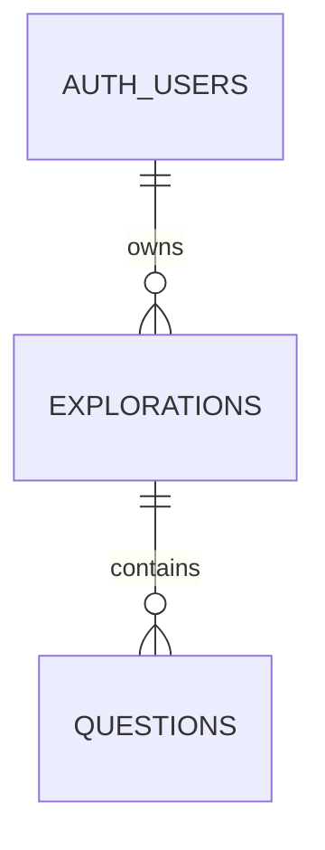

# Data Model

## Status
The relational schema below is the approved persistent contract (D-007, D-011, D-012, and D-016). It is implemented in `supabase/migrations/20261011162400_create_explorations.sql`, which has been applied to the hosted project, and `supabase/migrations/20261013191000_add_question_hidden.sql`, which has been applied to the hosted project. The signed-in home lists saved explorations and opens the one the user selects. The workspace can hide and restore questions. Rename and delete are not built. pgTAP has not been run, so the policy tests are not evidence of runtime isolation.

Two stores are described on purpose. The prototype store records the earlier in-memory page. The migration is the persistent contract the workspace now uses.

## Prototype store
`app/page.tsx` keeps one exploration in React state. There is no session record.

```ts
type QuestionRole = "central" | "satellite";
type PerspectiveId = "investigate" | "reframe" | "connect" | "challenge";

type Question = {
  id: number;
  text: string;
  color: string;
  role: QuestionRole;
  isPrioritised: boolean;
  perspectiveOrigin?: PerspectiveId;
};
```

Also in component state: `mode` (`"Focus"` or `"Quickfire"`), `ended` (boolean), the selected id, the map or list view, the composer text, and the open perspective.

Observed rules:

- The page loads a seeded Focus exploration. Those sample rows are not user data.
- New ids are `Date.now()` numbers. Colour is chosen from a fixed palette at insert time, except the seeded rows, which carry their own colours.
- The first question added to an empty Focus exploration becomes `central`. Later questions, and all new Quickfire questions, are `satellite`.
- `perspectiveOrigin` is set only when a Focus starter fills the composer and that question is added. Quickfire questions omit it. Switching mode does not strip origins already stored.
- `isPrioritised` defaults to `false`. The review toggles it only after the session has ended. Priority does not change text, order, role, or colour.
- Order is the array order. There is no `createdAt`.
- Ending the session sets `ended`. Start new exploration clears the array. Completion in the prototype is not stored anywhere else.
- Counts are derived from the array. Orbits are derived from layout.
- The unused `components/curitopia-app.tsx` model, with fixed angles and invented journey numbers, is not this contract.

An earlier suggestion used string ids, `createdAt`, `centralQuestionId`, and an `ExplorationSession` object. The page never stored that object. `centralQuestionId` would duplicate `role`. The approved store keeps a single role field.

## Approved persistent store
PostgreSQL, as provided by Supabase. Names below are the approved contract. Application types can keep the prototype's field names at the UI edge and map them at the data boundary.

Auth credentials stay in Supabase Auth (`auth.users`). Application tables do not store passwords, session tokens, or email addresses.

### Explorations
One row is one saved exploration for one user.

| Column | Type | Meaning |
| --- | --- | --- |
| `id` | `uuid`, primary key | Client-generated UUID. A retry of the same create uses the same id. |
| `user_id` | `uuid`, not null, references `auth.users(id)` on delete cascade | Owner. This is the only ownership column. |
| `title` | `text`, null | User-chosen name. Null means the interface shows a fallback. |
| `mode` | `text`, not null | `quickfire` or `focus`. UI labels remain Quickfire and Focus. |
| `status` | `text`, not null | `active` or `completed`. |
| `started_at` | `timestamptz`, not null, default `now()` | Server time when the exploration was created. |
| `ended_at` | `timestamptz`, null | Server time when it was completed. Null while active. |
| `created_at` | `timestamptz`, not null, default `now()` | Server insert time. |
| `updated_at` | `timestamptz`, not null, default `now()` | Server time of the last change to the exploration or its questions. |

Checks:

- `mode` is `quickfire` or `focus`.
- `status` is `active` or `completed`.
- An active row has `ended_at` null. A completed row has `ended_at` set.
- `title` is null, or its trimmed length is between 1 and 120 characters (D-011). The stored title is the trimmed value.

`user_id` is the owner. Questions do not copy `user_id`. A second owner column would need extra checks to stop it drifting from the parent. Cascade from `auth.users` deletes explorations, and cascade from explorations deletes questions.

Index: `(user_id, updated_at desc)` for the library.

### Questions
One row is one question in one exploration.

| Column | Type | Meaning |
| --- | --- | --- |
| `id` | `uuid`, primary key | Client-generated UUID so a retried insert is the same question. |
| `exploration_id` | `uuid`, not null, references `explorations(id)` on delete cascade | Parent exploration. |
| `position` | `integer`, not null | Zero-based entry order. Unique within the exploration. |
| `question_text` | `text`, not null | Full question text. The prototype calls this `text`. |
| `role` | `text`, not null | `central` or `satellite`. |
| `is_prioritised` | `boolean`, not null, default `false` | Priority flag. |
| `is_hidden` | `boolean`, not null, default `false` | Hidden questions stay stored and can be restored. Existing rows receive `false`. |
| `perspective_origin` | `text`, null | `investigate`, `reframe`, `connect`, `challenge`, or null. |
| `created_at` | `timestamptz`, not null, default `now()` | Server insert time. Order uses `position`, because two inserts can share a timestamp. |

Checks and indexes:

- `(exploration_id, position)` is unique, and `position` is greater than or equal to 0.
- Stored `question_text` is the trimmed value. Its length is from 1 to 2,000 characters (D-011). Longer input is rejected in the composer and by the database check.
- `role` is `central` or `satellite`.
- A partial unique index on `(exploration_id)` where `role = 'central'` allows at most one central question.
- `questions_central_stays_visible` rejects a row whose role is `central` and whose `is_hidden` is true.
- `perspective_origin` is null or one of the four Focus values.
- Index `(exploration_id, position)` matches the unique key used to load the map and the list.

On insert, a before-insert trigger replaces any client-supplied `position` with one greater than the current maximum for that exploration, or `0` when it is the first question. The unique `(exploration_id, position)` constraint rejects a colliding update or a concurrent insert. A retry whose question id already exists fails on the primary key. The application treats that conflict as success and reloads the row.

### Relationships
- One auth user owns many explorations.
- One exploration contains many questions.
- Deleting an exploration deletes its questions.
- Deleting the auth user deletes that user's explorations and questions.
- Questions are ordered by `position` ascending. Hiding a question does not change that position and does not delete the row. This phase does not reorder or permanently delete individual questions.



### Values that stay derived
These are not columns:

- Question count and prioritised count shown on the map, list, and review. Those visible counts exclude hidden questions. The library count does the same and shows a separate hidden count when one exists.
- Orbit count and map coordinates.
- Node colour. It is a pure function of `questions.id` and the fixed palette below. It is not a column. The same id always maps to the same colour. Seeded prototype colours are not user data and are not copied into new accounts.
- Selected question, map or list view, composer draft, and which perspective panel is open. A draft is not a question until Add Question accepts it.
- The library display title when `title` is null: central question text, otherwise the first visible question by position, otherwise "Untitled exploration". A central question cannot be hidden.

The visual hub used when every role is `satellite` is the first question by position. Loading a Quickfire exploration does not write `central` onto that row.

Colour uses this palette, in this order:

`#55baff`, `#a969f4`, `#71e7bf`, `#ef8bc2`, `#ffb84d`.

Take the first eight hexadecimal characters of the UUID, parse them as a base-16 integer, and use that value modulo 5 as the palette index. Do not use `position`, `Math.random()`, or a stored colour. Hyphens in the UUID are ignored before the slice.

### Integrity rules
Application writes and database checks both apply.

- Quickfire inserts store `perspective_origin` as null. A Focus insert may store one of the four origins or null. Changing mode later does not rewrite origins already saved.
- New questions are inserted with `is_prioritised` false and `is_hidden` false.
- Priority updates are accepted when the exploration is `completed`. The review UI is the only control that sends them.
- The first question in an empty Focus exploration is stored as `central` if the exploration has no central question. Every later question is `satellite`. Quickfire inserts are `satellite`.
- A central question cannot be hidden. The database check rejects that update. The interface does not choose another central question; a different centre means a new exploration.
- At least one question in an exploration stays visible. Hiding the last visible question is rejected. The trigger locks the parent exploration so two overlapping hides cannot both succeed.
- Hiding or restoring a question does not change `status` or `ended_at`. A completed exploration stays completed.
- Hidden questions remain stored with their id, text, position, role, priority, and perspective origin. Restoring sets `is_hidden` back to false.
- The normal map, list, and visible counts omit hidden questions. The interface offers a way to reveal hidden questions and restore one. That interface is not built yet.
- Future AI analysis excludes hidden questions unless the user explicitly includes them.
- Completing an exploration sets `status` to `completed` and `ended_at` to server time. This phase does not move a completed exploration back to `active`.
- The first saved question and its exploration commit in one transaction. A deferred constraint rejects an exploration that commits with no questions. The library query also hides any exploration that has no questions.
- A title chosen before the first save is included on that insert. It does not create a row by itself.
- `updated_at` on the exploration moves forward when the exploration row changes and when a question is inserted or its priority changes. A database trigger does that, so the library order does not depend on the client remembering a parent update.
- A trigger rejects a Quickfire insert that includes a perspective origin, and rejects a priority change while the exploration is still active.

Last-write-wins is accepted for a single user's priority toggle or rename. Inserts rely on the primary key and the position constraint so a retry or an overlapping add does not silently duplicate a question or collapse the order.

### Row-level security
Enable row-level security on both tables. Grant no policies to the anonymous role.

Explorations, for the `authenticated` role:

- Select, update, and delete only where `user_id = auth.uid()`.
- Insert only when the new `user_id` is `auth.uid()`.
- Updates cannot change `user_id` to someone else.

Questions, for the `authenticated` role:

- Select, insert, update, and delete only where the parent exploration exists and that exploration's `user_id` is `auth.uid()`.

The same not-found behaviour should be used for a missing id and for another user's id, so a guess does not reveal that an exploration exists.

### Table sketch
This sketch matches the migration. It is documentation, not the file that runs. The same statements have been applied to the hosted project.

```sql
create table public.explorations (
  id uuid primary key,
  user_id uuid not null references auth.users (id) on delete cascade,
  title text,
  mode text not null,
  status text not null,
  started_at timestamptz not null default now(),
  ended_at timestamptz,
  created_at timestamptz not null default now(),
  updated_at timestamptz not null default now(),
  constraint explorations_mode_check check (mode in ('quickfire', 'focus')),
  constraint explorations_status_check check (status in ('active', 'completed')),
  constraint explorations_title_check check (
    title is null
    or (
      title = btrim(title)
      and char_length(title) between 1 and 120
    )
  ),
  constraint explorations_completion_check check (
    (status = 'active' and ended_at is null)
    or (status = 'completed' and ended_at is not null)
  )
);

create table public.questions (
  id uuid primary key,
  exploration_id uuid not null references public.explorations (id) on delete cascade,
  position integer not null,
  question_text text not null,
  role text not null,
  is_prioritised boolean not null default false,
  is_hidden boolean not null default false,
  perspective_origin text,
  created_at timestamptz not null default now(),
  constraint questions_position_check check (position >= 0),
  constraint questions_position_unique unique (exploration_id, position),
  constraint questions_text_check check (
    question_text = btrim(question_text)
    and char_length(question_text) between 1 and 2000
  ),
  constraint questions_role_check check (role in ('central', 'satellite')),
  constraint questions_origin_check check (
    perspective_origin is null
    or perspective_origin in ('investigate', 'reframe', 'connect', 'challenge')
  ),
  constraint questions_central_stays_visible check (
    role <> 'central' or is_hidden = false
  )
);

create unique index questions_one_central
  on public.questions (exploration_id)
  where role = 'central';
```

Policies, the `updated_at` trigger, the Quickfire-origin trigger, the completed-only priority trigger, and the deferred non-empty exploration check are in the first migration. `is_hidden`, `questions_central_stays_visible`, and `questions_prevent_hiding_last_visible` are in `supabase/migrations/20261013191000_add_question_hidden.sql`. That second migration has not been applied to the hosted project. pgTAP coverage is in `supabase/tests/explorations_rls.test.sql` and `supabase/tests/questions_hidden.test.sql`. Run them with `supabase test db` after `supabase start`. The tests are not evidence of security until that command has been run and passed.

### Writes
`public.create_exploration_with_first_question` inserts the exploration and its first question in one statement. It sets `user_id` from `auth.uid()` and does not accept an owner argument. Only `authenticated` may execute it. A deferred constraint rejects a transaction that commits an exploration with no questions.

Later changes are ordinary statements by the signed-in user:

- Insert another question with `id`, `exploration_id`, `question_text`, `role`, and optional `perspective_origin`. Omit `position`.
- Rename, change mode, or set `status` to `completed`. The completion trigger sets `ended_at` to server time. A completed exploration cannot return to `active`.
- Update `is_prioritised` only after the exploration is completed.
- Update `is_hidden` on a satellite. The database rejects hiding a central question and rejects hiding the last visible question. Setting `is_hidden` back to false restores the question. Neither change deletes the row or reopens a completed exploration.
- Delete the exploration. The foreign key deletes its questions.

Email confirmation is an authentication rule for the later application work. These tables recognise a signed-in `authenticated` user; they do not store a confirmation flag.

## Mapping from the prototype
| Prototype | Approved column |
| --- | --- |
| Question `id: number` | `questions.id` UUID |
| Question `text` | `questions.question_text` |
| Question `color` | Derived from `questions.id`; not stored |
| Question `role` | `questions.role` |
| Question `isPrioritised` | `questions.is_prioritised` |
| No prototype field | `questions.is_hidden` |
| Question `perspectiveOrigin` | `questions.perspective_origin` |
| Array order | `questions.position` |
| `mode` `"Focus"` / `"Quickfire"` | `explorations.mode` `focus` / `quickfire` |
| `ended` boolean | `explorations.status` and `ended_at` |
| No title | `explorations.title` |
| No owner | `explorations.user_id` |
